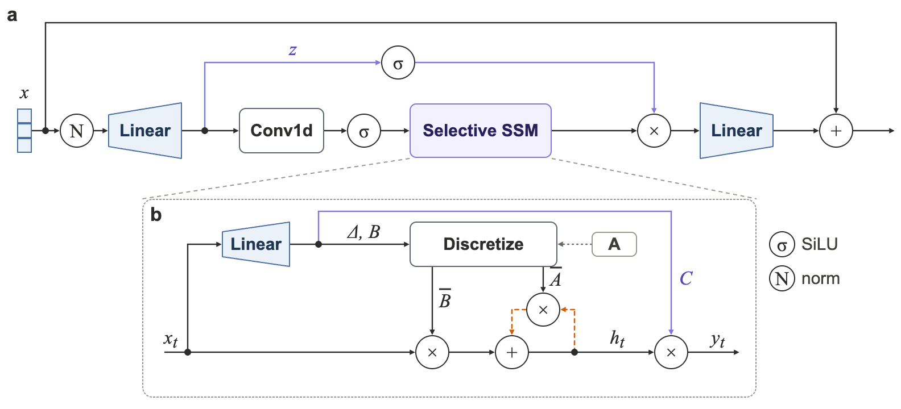
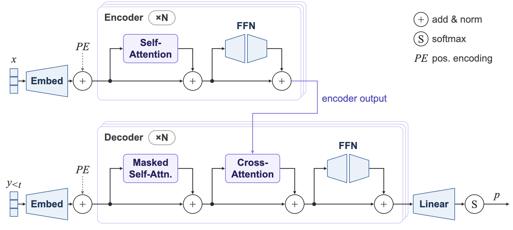
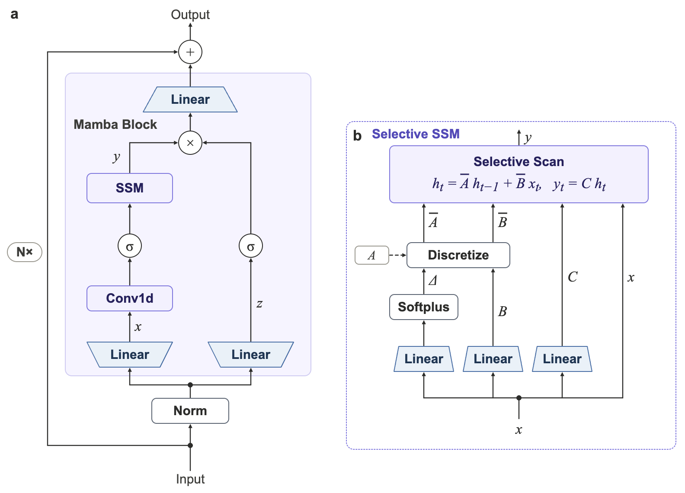
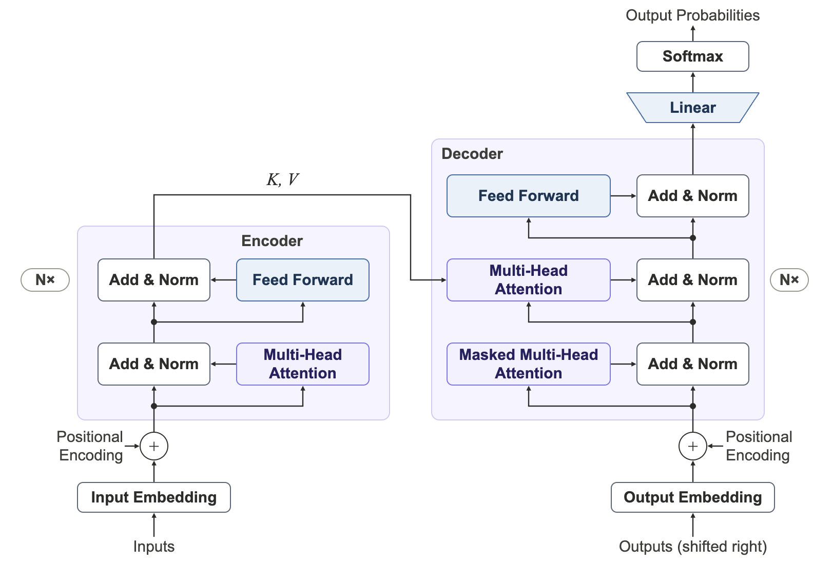
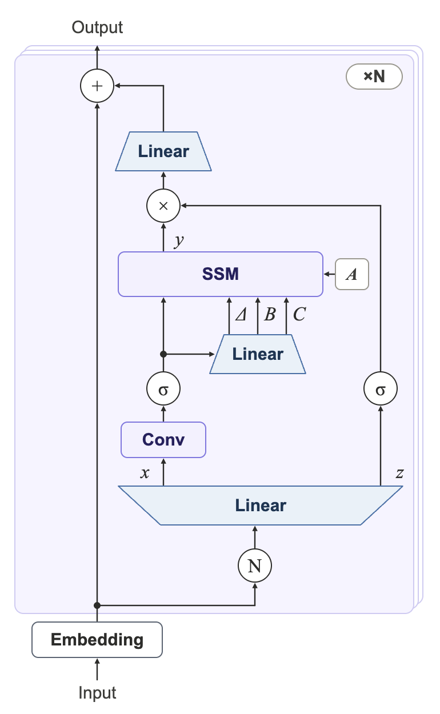
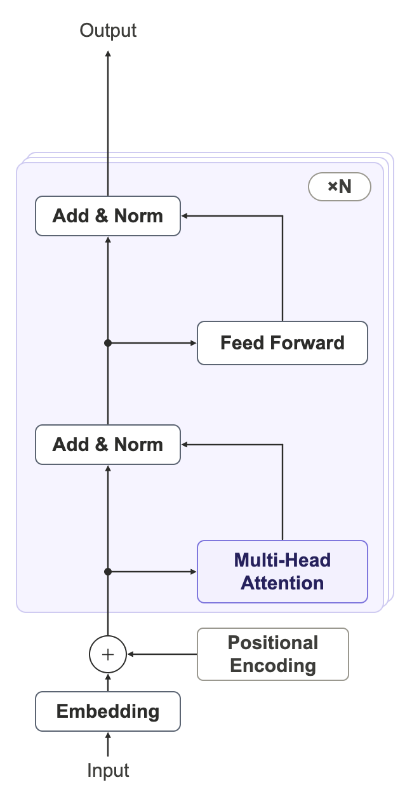
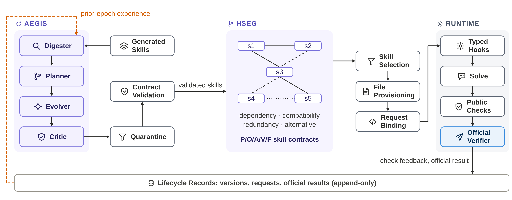

# paper-figure

An agent skill for drawing research-paper figures (method overviews, pipelines, architectures) as editable
vector diagrams. It does not use image-generation models.

Ask an agent for a figure and you usually get text that leaves its box, labels that overlap and lines that
miss their targets. This skill measures every draft at the size it will be printed and fixes it until the
errors are zero, before you see it.

https://github.com/user-attachments/assets/f9675aaa-f659-4a25-adb0-ea746bc069b1

Video file: [docs/demo.mp4](docs/demo.mp4) · GIF version: [docs/demo.gif](docs/demo.gif). The demo is a re-creation of the workflow; the figures
and the audit results in it are real output of the skill.

## What it does

- **Keeps your structure.** It lists every module, arrow, boundary and loop in a ledger before editing and
  checks that none of them disappeared afterwards.
- **Sizes text for the venue.** Presets for ICML, NeurIPS, ICLR, ACL, AAAI, CVPR, IEEE, ACM and Nature,
  or any width you give it. Text is measured in printed points, not screen pixels.
- **Compares before it commits.** It looks at reference figures from top papers, draws two or three
  layout candidates, and shows them side by side for you to choose.
- **Measures the result.** A script reports text that is too small, text outside its box, overlaps, thin
  lines, text on grey and near-miss alignment, and renders greyscale and colour-blind views.
- **Exports for the manuscript.** A vector PDF with embedded fonts for LaTeX and a 300 dpi PNG for Word
  or slides.

## Install

Copy the `paper-figure` folder into your agent's skills directory (for Claude Code:
`~/.claude/skills/paper-figure/`), then:

```bash
pip install playwright numpy pillow
python3 -m playwright install chromium
# optional, enables the PDF font check: poppler-utils
```

## Try it

```bash
cd examples/react-agent
python3 gen_fig.py
python3 ../../scripts/figure_audit.py project/Main.dc.html --venue nature
python3 ../../scripts/dc_export.py . --out out --venue nature
```

| Example | Shows | Venue preset |
|---|---|---|
| `examples/react-agent` | system figure: icon cards, panels, chips, a state bar, a feedback loop | `nature`, 6.9 pt |
| `examples/transformer-block` | architecture figure: trapezoids, operation circles, a repeated block | `icml`, 9.2 pt |
| `examples/rag-pipeline` | the smallest possible board | `icml`, 9.2 pt |

All three pass the audit with zero errors, and their PDFs embed every font and contain no raster images.

Or ask your agent: "Draw the overview figure for my method. Target venue: ACL."

## Layout

```
SKILL.md            workflow and rules the agent follows
scripts/            dc_board.py (draw), figure_audit.py (measure), dc_export.py (export)
references/         venues, style, drawing boards, credits
examples/           three runnable figures
```

## Examples by model

Same skill, same request, three Claude models. Each figure was drawn on a Claude Design canvas and passed
the audit.

| | Mamba | Transformer |
|---|---|---|
| **Fable 5.2** |  |  |
| **Opus 5.5** |  |  |
| **Sonnet 5.5** |  |  |

Author's impression from these runs (one run per model, not a benchmark): Fable 5.2 was the fastest and
the most detailed; Opus 5.5 was slower with quality close to Fable; Sonnet 5.5 was simpler but usable.
The Fable figures were drawn in the session where the skill was being developed, the others in fresh
sessions.

### From a real repository

The overview of [Merlin](https://github.com/WonJeong0913/merlin), drawn from its README and code map:



## Requirements and limits

- Python 3, Playwright with Chromium. A Claude Design canvas is optional.
- Built for diagrams. Data plots (line, bar, scatter) are out of scope.
- Venue presets were checked against each venue's author kit in November 2026. Templates change, so
  confirm against the current one before submission.

## Credits and licence

Borrowed procedures are listed in `references/credits.md`. Licence: see `LICENSE`.
